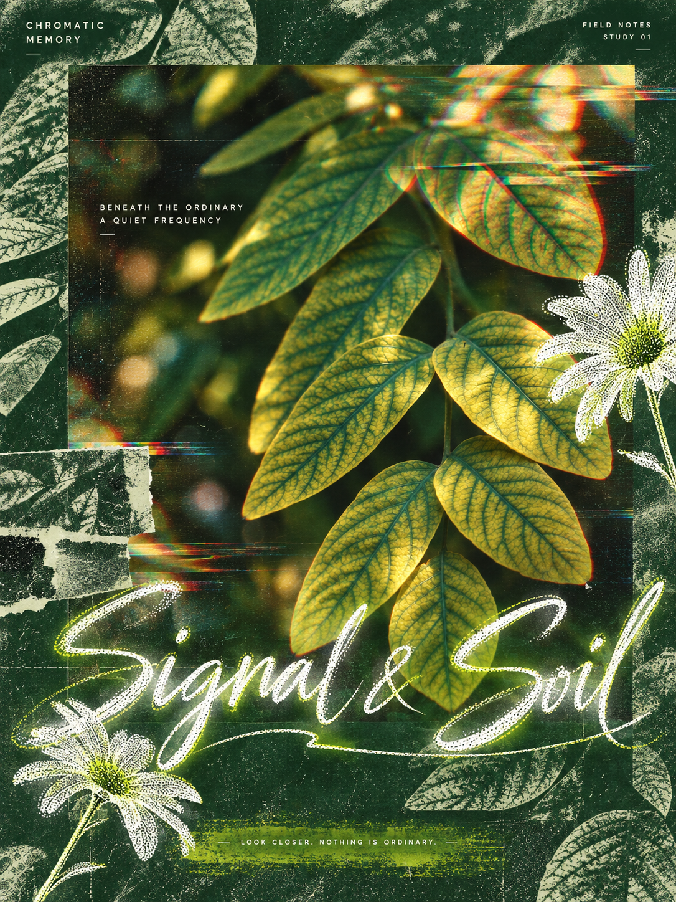
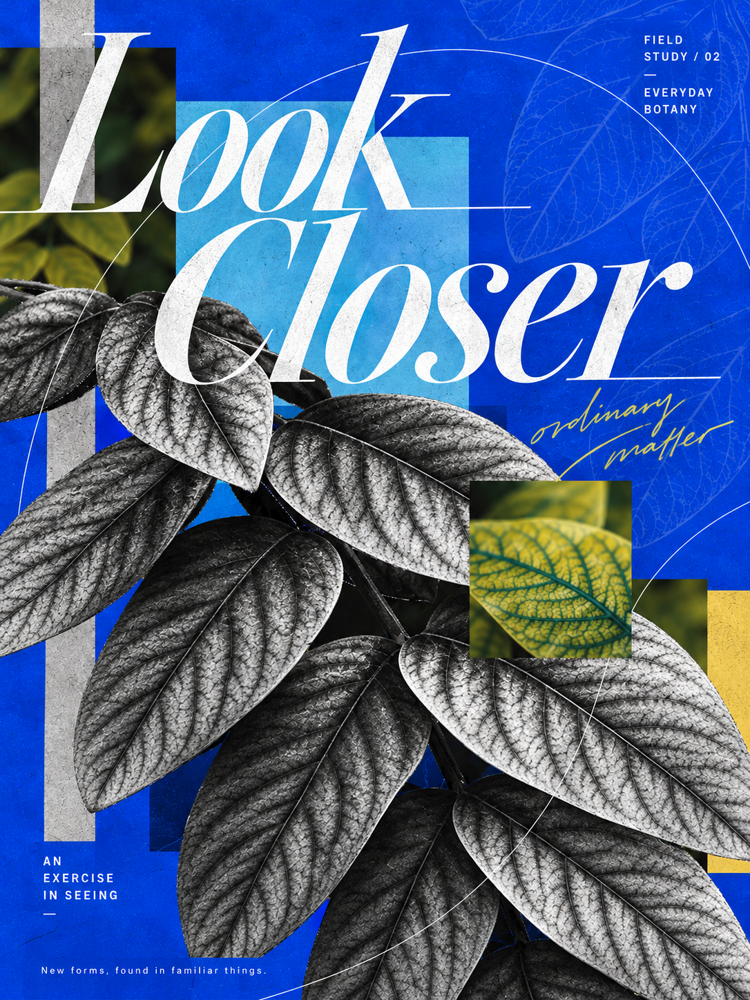

# 黄白设计

把普通随拍，分步做成有层次的海报。

优先使用**自然数字拼贴**和**高反差摄影构成**，尤其适合建筑、树、叶片与日常物件。先处理摄影、底纹和字形，再合成排版；保留原照、过程图和实际提示词。

<table>
  <tr><th>自然数字拼贴</th><th>高反差摄影构成</th></tr>
  <tr>
    <td></td>
    <td></td>
  </tr>
</table>

图示为真实多步练习结果。底图来源与参考作者见[来源说明](references/sources.md)。

## 安装与使用

在 Codex 等支持 Skill 的助手中，提供仓库链接并说：

> 安装这个 Skill：https://github.com/huangbai-AI/huangbai-design

也可以在尚未安装时手动复制到 Codex 的技能目录：

```bash
git clone https://github.com/huangbai-AI/huangbai-design.git ~/.codex/skills/huangbai-design
```

然后上传自己的照片，说：

> 使用黄白设计，把这张照片分步制作成海报，保留过程图。

也可直接调用 `$huangbai-design`。需要图片生成能力；模型账号、工具接入和费用按你使用的平台配置，本仓库不包含授权密钥或生图额度。

## 包含哪些方法

| 优先级 | 设计路线 |
|---|---|
| 主推 | 自然数字拼贴、高反差摄影构成 |
| 按照片选择 | 物体材质文字、多层摄影拼贴、国风拓印、秋日颗粒 |
| 备选 | 双色半调网屏、柔焦弥散、单色木刻版画、复古像素故障 |

[适用照片与选型规则](references/style-selection.md) · [完整技能入口](SKILL.md)

## 多步不是重复重画

- **自然数字拼贴**：原照分别制作复印底图和彩色摄影；另做字形素材；最后合成，典型4步。
- **高反差摄影构成**：原照分别制作黑白主体、原色切片与几何底图；最后合成排版，典型3步。
- **其他路线**：根据工艺拆成材质、构图、字体等实际阶段，每步保存结果。

修改时优先从原照或合格分支出发，减少连续整图重画。细节、纹理与颜色各有作用，不能用全图色罩补救，也不强制所有风格遵守三色。

[制作与修改规则](references/workflow.md) · [过程记录格式](references/process-record.md)

## 案例与验证程度

仓库收录17个案例条目：

- 两种主推风格的完整分支过程、原版素材与成品。
- 四条参考对应的八组实际三步练习，包含24条原始指令与过程预览。
- 四种备选风格的历史单步示意。
- 三个额外的用户选中参照；另外两个选中结果已在八组中收录。

四种备选风格的新多步方案**尚未按新方案生成验证**。方法由教程拆解或成品反推，再转译为模型执行指令，不冒充参考作者的原始 Skill、原提示词或实际 Photoshop 操作。没有承诺所有照片、所有模型一次成功。

[案例索引](references/cases.md) · [参考出处与验证程度](references/sources.md)

## 对照不同模型

Image 与可灵共用原照、文案和阶段目标，各自独立生成素材与成品。一侧的图片不能输入另一侧；记录各自的实际规格和必要接口适配。案例图只供看方法，不是新任务默认的生成输入。

## 授权与素材出处

原创技能说明、制作规则与复现提示词采用 [MIT 许可](LICENSE)。第三方照片、参考作品及含有第三方底图的练习图不属于该许可的授权范围，原有权利与署名保留；公开仓库不改变这些素材的权利归属。详见 [素材说明](NOTICE.md)。
