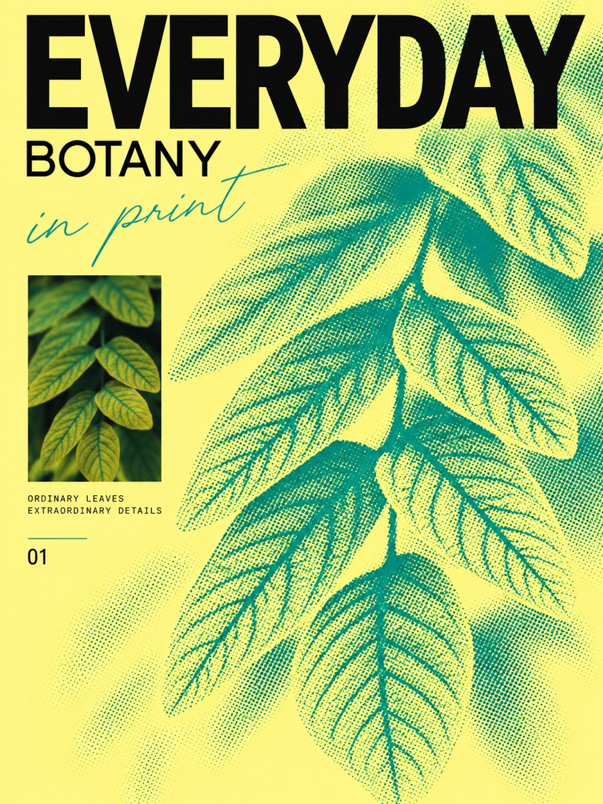

# 四种备选风格的历史单步示意

这些旧图各为一次生成；新的分步制作方案见[备选风格](../../styles/alternatives.md)，尚未按该新方案生成验证。

## 01｜双色半调网屏

参考：[章章晴子《How to｜夏日半调网屏海报设计》](https://www.xiaohongshu.com/user/profile/59a82d2a50c4b424c2340d72/6a0580260000000035023b8d)

[当次单次指令](01-原始单次指令.txt)

## 02｜柔焦弥散

参考：[章章晴子《howto｜有手就会！柔焦模糊海报全流程教程！》](https://www.xiaohongshu.com/user/profile/59a82d2a50c4b424c2340d72/6a1cfd270000000035030be2)

[当次单次指令](02-原始单次指令.txt)

## 03｜单色木刻版画

参考：[章章晴子《Aha这也是艺术｜一张木刻版画感海报怎么做》](https://www.xiaohongshu.com/user/profile/59a82d2a50c4b424c2340d72/6a9e2ec9000000002700bdaf)

[当次单次指令](03-原始单次指令.txt)

## 04｜复古像素故障

参考：[孙师傅.DES《一组绿意系列海报｜复古像素故障风》](https://www.xiaohongshu.com/user/profile/59ec0b7be8ac2b4310b02830/6ad1e6cb0000000018010af2)

[当次单次指令](04-原始单次指令.txt)

