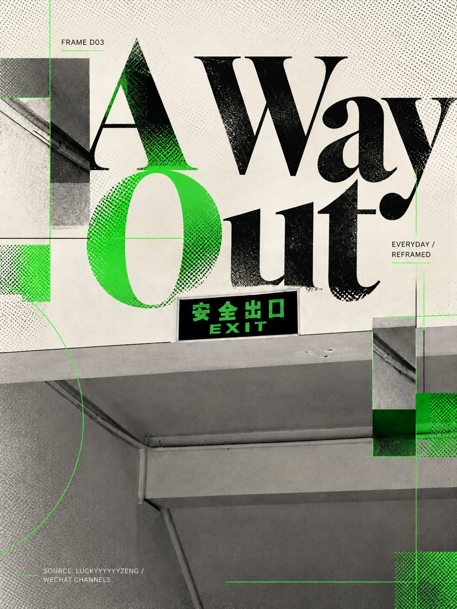
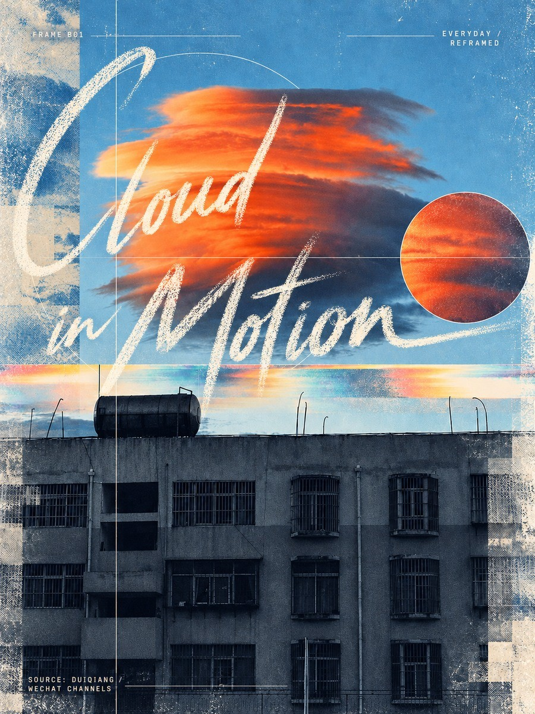
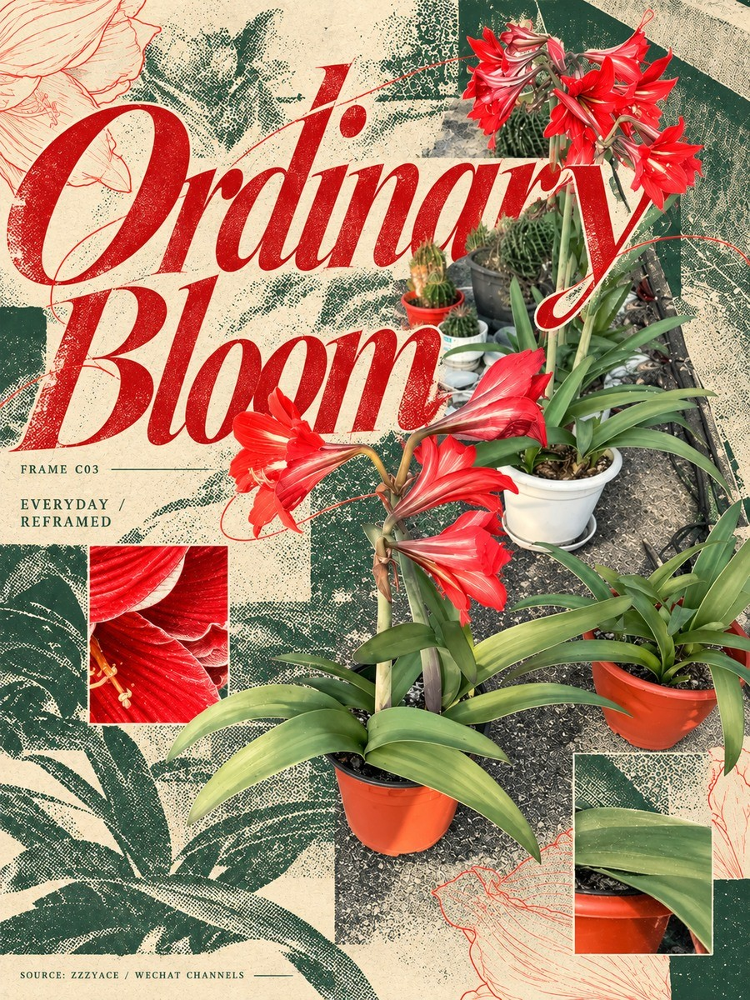

# 用户标“1”的五个审美参照

## 安全出口

该结果为用户在原工作文档中评论“1”的选中案例。

文档脚本中的两步目标效果示例，文内操作文案拟用于Lovart；不能冒充Lovart已完成或该图实际工具调用日志。下附D03指令属于同题另一版。

[原33组档案中的同题指令](D03-原始流程与提示词.txt)

## 橙色云团

该结果为用户在原工作文档中评论“1”的选中案例。

原33组档案中的两步路线：原照→照片处理稿；原照＋处理稿→合成排版。

[原33组档案中的同题指令](B01-原始流程与提示词.txt)

## 屋顶红花盆栽

该结果为用户在原工作文档中评论“1”的选中案例。

原33组档案中的两步路线：原照→照片处理稿；原照＋处理稿→合成排版。

[原33组档案中的同题指令](C03-原始流程与提示词.txt)

## 另两处标“1”

[向日葵半调拼贴](../new-03/history.md)与[银杏秋日颗粒](../new-08/history.md)的原图、三步过程和指令已分别收录，不重复复制。

## 审美共同点

保留真实摄影，用同源素材的尺度差、印刷与摄影对比、图文遮挡形成层次；不能把所选效果归结为一个色板或同一种字体。
