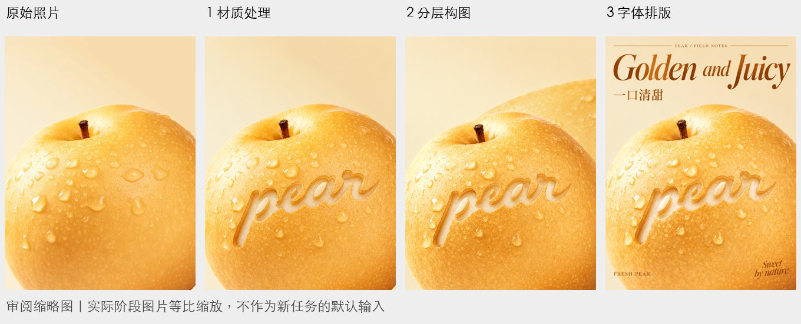

# 金梨雕刻｜真实三步案例

参考：[ 陈_AI绘画笔记｜howto雕刻效果海报 I 海报新玩法～ ](https://www.xiaohongshu.com/explore/6ad5af32000000002600ab11)

原照片：视频约 0 秒，直接裁出图片区域，未先用AI重建。

旧例模型为LibTV Image 2.5 Fast、1K低画质，三次生成；不是新任务的默认画质。参考成品仅用于分析，没有作为当次生成输入。作者教程操作、成品反推与生图阶段的区别见[来源说明](../../sources.md)。

## 1 素材与材质

输入：原视频处理前照片。

[当次完整指令](01-提示词.txt)

## 2 分层与构图

输入：原视频处理前照片（主体锚点）；本模型步骤1结果（视觉基础）。

[当次完整指令](02-提示词.txt)

## 3 字体与精修

输入：原视频处理前照片（主体锚点）；本模型步骤2结果（视觉基础）。

[当次完整指令](03-提示词.txt)

[完整输入输出与图像溯源](输入输出关系.json)
