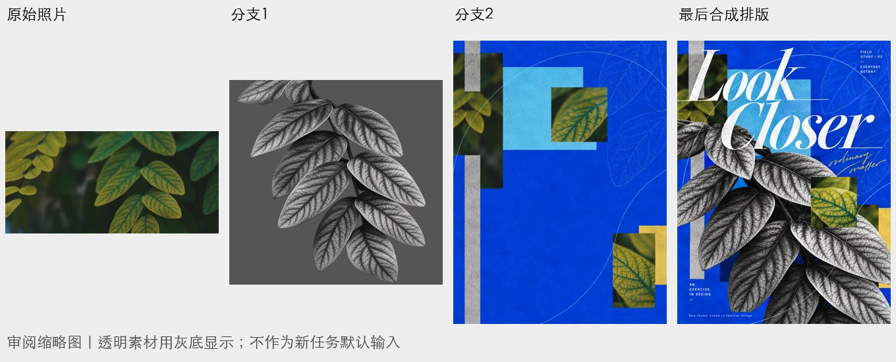

# 高反差摄影构成｜真实分步案例

参考作者：章章晴子。参考视频：https://www.xiaohongshu.com/explore/6ad19b920000000015014857

原照片来自ROMAN ODINTSOV的Pexels叶片视频约2秒，非黄白本人拍摄。原案例用内置图片工具制作，具体模型版本未记录。

方法来源：原片约16–22秒处理黑白主体与颗粒；约29–33秒把点线面、彩色照片和主体重新组合；约45–56秒单独设计字体并处理大小位置与疏密。本次迁移其工艺组合和构成逻辑，主体与版式为新作。

实际阶段是独立素材分支后合成；提示词为复现练习，不是作者原词。

[原始输入输出关系](输入输出关系.json)

## 1 黑白摄影抠图
输入：原始植物帧。
[实际提示词](分步提示词/01-黑白摄影抠图.txt)

## 2 彩色切片与几何
输入：原始植物帧。
[实际提示词](分步提示词/02-彩色切片与几何.txt)

## 3 合成与排版
输入：前述本模型素材分支。
[实际提示词](分步提示词/03-合成与排版.txt)

## 本次原件核对

[尺寸、颜色模式与透明通道的实际检查](文件实查.json)。提示词请求透明不等于实际有透明；复用工艺时以本次输出实际通道为准，不能把纯底素材称为透明抠图。
