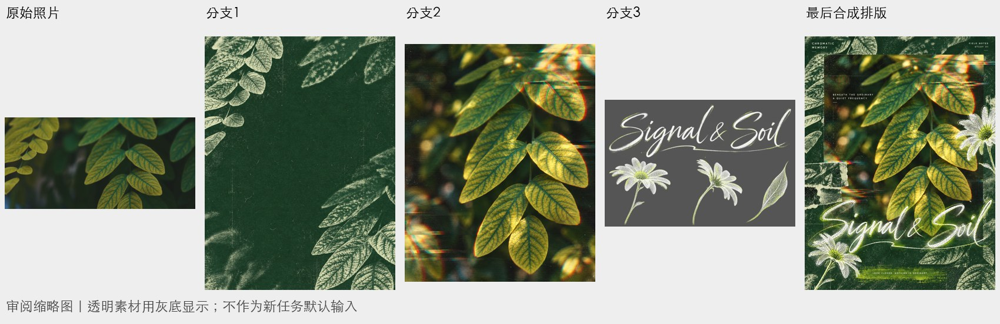

# 自然数字拼贴｜真实分步案例

参考作者：孙师傅.DES。参考视频：https://www.xiaohongshu.com/explore/6ad1e6cb0000000018010af2

原照片来自ROMAN ODINTSOV的Pexels叶片视频约2秒，非黄白本人拍摄。原案例用内置图片工具制作，具体模型版本未记录。

方法来源：原片约17–26秒分别展示照片故障艺术与Xerox噪点；约31–41秒制作绿色底图与照片窗口；约47–54秒单独处理标题；约65秒可见ASCII艺术用于花卉装饰。画面中个别菜单停留和字幕并不完全一致，因此未把混合模式名称记成可确认参数。

实际阶段是独立素材分支后合成；提示词为复现练习，不是作者原词。

[原始输入输出关系](输入输出关系.json)

## 1 复印质感底图
输入：原始植物帧。
[实际提示词](分步提示词/01-复印质感底图.txt)

## 2 彩色色散前景
输入：原始植物帧。
[实际提示词](分步提示词/02-彩色色散前景.txt)

## 3 字形与点阵花卉
输入：纯文字生成。
[实际提示词](分步提示词/03-字形与点阵花卉.txt)

## 4 合成与排版
输入：前述本模型素材分支。
[实际提示词](分步提示词/04-合成与排版.txt)

## 本次原件核对

[尺寸、颜色模式与透明通道的实际检查](文件实查.json)。提示词请求透明不等于实际有透明；复用工艺时以本次输出实际通道为准，不能把纯底素材称为透明抠图。
